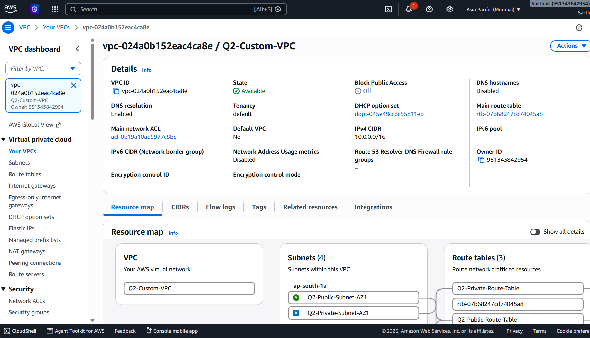
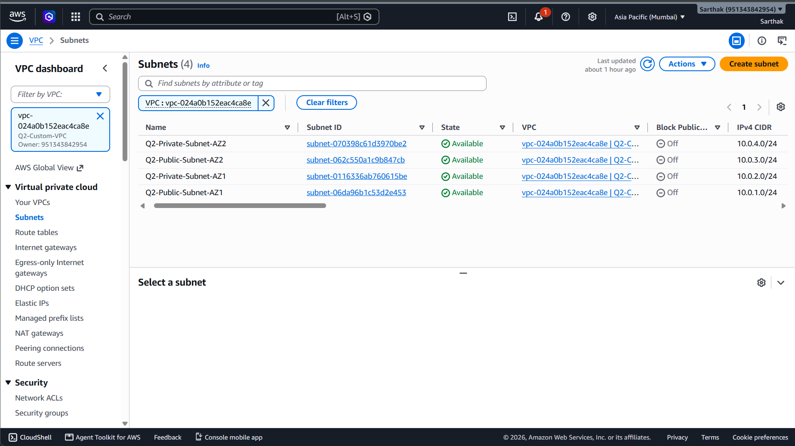
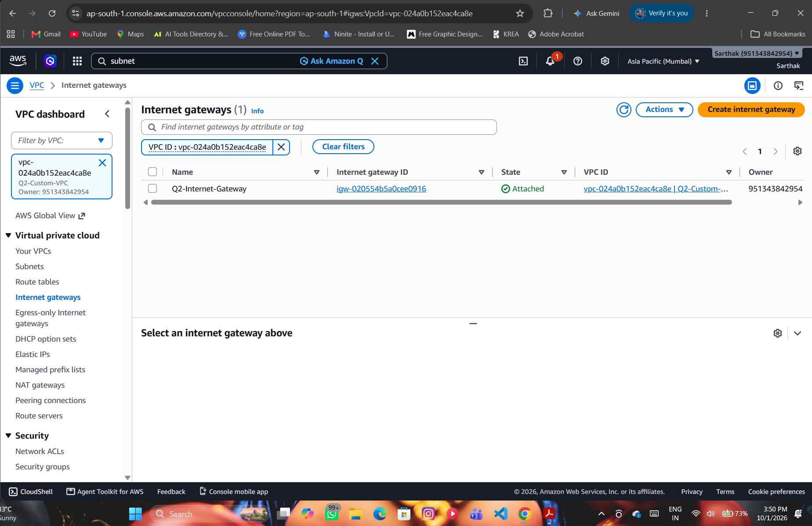
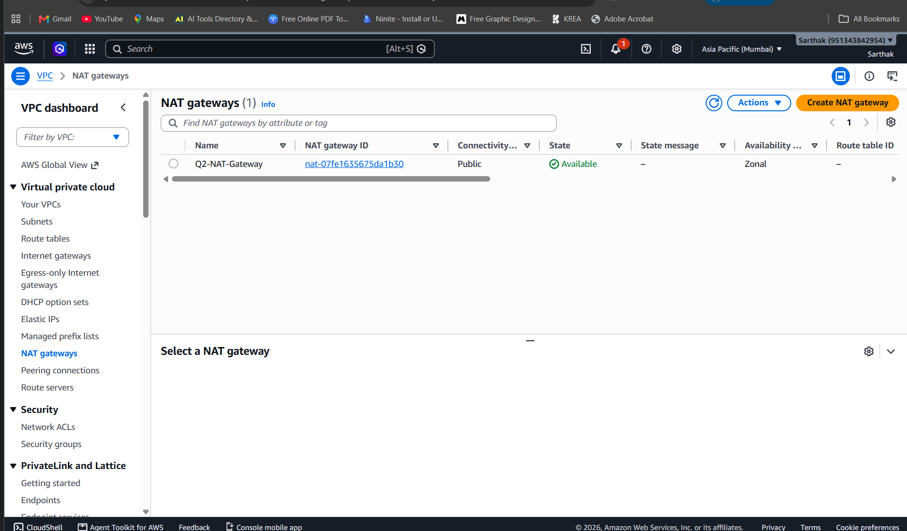
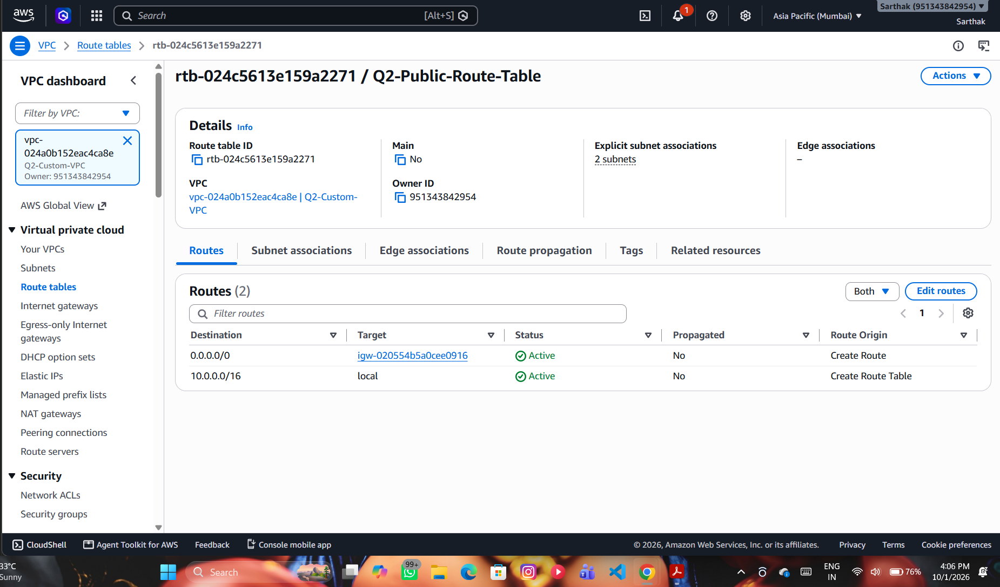
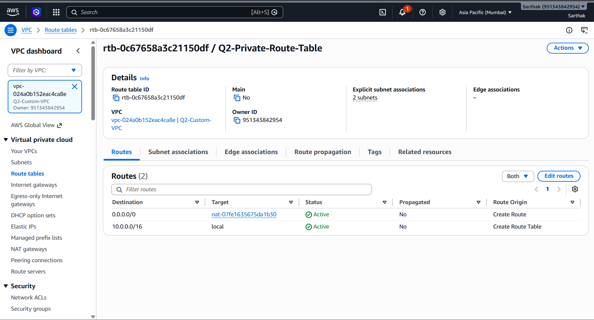
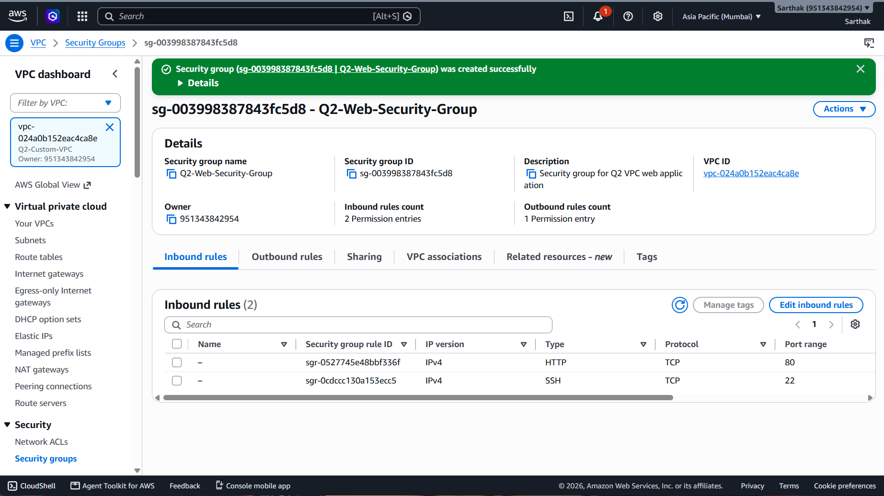

# AWS Q2 – Custom VPC Network Architecture

## 📌 Project Overview

This project implements a custom AWS network architecture for a web application using Amazon VPC.

The architecture is designed across **two Availability Zones** and includes public and private subnets, an Internet Gateway, a NAT Gateway, route tables, and a Security Group.

---

## 🎯 Assignment Objective

Build a complete AWS network architecture containing:

- Custom VPC
- Two Availability Zones
- Public and Private Subnets
- Internet Gateway
- NAT Gateway
- Public and Private Route Tables
- Security Group
- Proper routing between the components

---

## 🏗️ Architecture

The detailed architecture diagram and component explanation are available here:

[`architecture/architecture.md`](architecture/architecture.md)

### High-Level Flow

```text
                         Internet
                            |
                            v
                  Internet Gateway (IGW)
                            |
        +-------------------+-------------------+
        |            Q2-Custom-VPC              |
        |             10.0.0.0/16               |
        |                                       |
        |  Availability Zone 1                  |
        |  +-------------------------------+    |
        |  | Public Subnet                 |    |
        |  | 10.0.1.0/24                   |    |
        |  | NAT Gateway                   |    |
        |  +-------------------------------+    |
        |                  |                    |
        |                  v                    |
        |  +-------------------------------+    |
        |  | Private Subnet                |    |
        |  | 10.0.2.0/24                   |    |
        |  +-------------------------------+    |
        |                                       |
        |  Availability Zone 2                  |
        |  +-------------------------------+    |
        |  | Public Subnet                 |    |
        |  | 10.0.3.0/24                   |    |
        |  +-------------------------------+    |
        |                  |                    |
        |                  v                    |
        |  +-------------------------------+    |
        |  | Private Subnet                |    |
        |  | 10.0.4.0/24                   |    |
        |  +-------------------------------+    |
        +---------------------------------------+
```

---

## ☁️ AWS Services Used

| AWS Component | Purpose |
|---|---|
| Amazon VPC | Creates the isolated network |
| Availability Zones | Provides infrastructure separation across AZs |
| Public Subnets | Hosts resources requiring direct internet connectivity |
| Private Subnets | Provides isolated network space for internal resources |
| Internet Gateway | Enables internet connectivity for public subnets |
| NAT Gateway | Allows private subnet resources to access the internet without public IPs |
| Route Tables | Controls network traffic routing |
| Security Group | Controls inbound and outbound traffic |

---

## 🔧 VPC Configuration

| Setting | Value |
|---|---|
| VPC Name | `Q2-Custom-VPC` |
| IPv4 CIDR | `10.0.0.0/16` |
| Region | `ap-south-1` (Mumbai) |

---

## 🌐 Subnet Configuration

| Subnet | CIDR | Availability Zone | Type |
|---|---|---|---|
| `Q2-Public-Subnet-AZ1` | `10.0.1.0/24` | `ap-south-1a` | Public |
| `Q2-Private-Subnet-AZ1` | `10.0.2.0/24` | `ap-south-1a` | Private |
| `Q2-Public-Subnet-AZ2` | `10.0.3.0/24` | `ap-south-1b` | Public |
| `Q2-Private-Subnet-AZ2` | `10.0.4.0/24` | `ap-south-1b` | Private |

---

## 🌍 Internet Gateway

**Name:** `Q2-Internet-Gateway`

The Internet Gateway is attached to `Q2-Custom-VPC`.

The public route table uses the Internet Gateway as its default route:

```text
0.0.0.0/0 → Internet Gateway
```

This enables resources in the public subnets to communicate with the internet when they have the required public addressing and security rules.

---

## 🔄 NAT Gateway

**Name:** `Q2-NAT-Gateway`

The NAT Gateway is deployed in:

- Public Subnet: `Q2-Public-Subnet-AZ1`
- Availability Zone: `ap-south-1a`
- Connectivity type: Public
- Elastic IP: Allocated

The private route table uses the NAT Gateway for internet-bound traffic:

```text
0.0.0.0/0 → Q2-NAT-Gateway
```

This allows resources in private subnets to initiate outbound internet connections without requiring public IP addresses.

---

## 🛣️ Route Tables

### Public Route Table

**Name:** `Q2-Public-Route-Table`

Associated with:

- `Q2-Public-Subnet-AZ1`
- `Q2-Public-Subnet-AZ2`

Route:

```text
0.0.0.0/0 → Q2-Internet-Gateway
```

### Private Route Table

**Name:** `Q2-Private-Route-Table`

Associated with:

- `Q2-Private-Subnet-AZ1`
- `Q2-Private-Subnet-AZ2`

Route:

```text
0.0.0.0/0 → Q2-NAT-Gateway
```

---

## 🔐 Security Group

**Name:** `Q2-Web-Security-Group`

### Inbound Rules

| Type | Port | Source |
|---|---:|---|
| HTTP | 80 | `0.0.0.0/0` |
| SSH | 22 | My IP |

### Outbound Rules

Default outbound traffic is allowed:

```text
0.0.0.0/0
```

The Security Group controls which traffic is allowed to reach resources associated with it.

---

## 🔁 Network Traffic Flow

### Public Subnet

```text
Internet
   ↓
Internet Gateway
   ↓
Public Route Table
   ↓
Public Subnet
```

### Private Subnet – Outbound Internet

```text
Private Subnet
      ↓
Private Route Table
      ↓
NAT Gateway
      ↓
Internet Gateway
      ↓
Internet
```

---

## 🧪 Configuration Verification

The following components were configured and verified in the AWS Management Console:

- VPC created with `10.0.0.0/16`
- Four subnets created across two Availability Zones
- Internet Gateway attached to the VPC
- NAT Gateway created in the public subnet
- Public route table associated with both public subnets
- Private route table associated with both private subnets
- Public route configured through the Internet Gateway
- Private default route configured through the NAT Gateway
- Security Group configured for HTTP and SSH access

> Note: This project focuses on the network architecture configuration. No EC2 application deployment or end-to-end application connectivity test is included in this Q2 implementation.

---

## 📸 Screenshots

### 1. VPC



### 2. Subnets



### 3. Internet Gateway



### 4. NAT Gateway



### 5. Public Route Table



### 6. Private Route Table



### 7. Security Group



---

## 📁 Project Structure

```text
AWS-Q2-Custom-VPC-Network-Architecture/
│
├── architecture/
│   └── architecture.md
│
├── screenshots/
│   ├── 01-vpc.png
│   ├── 02-subnets.png
│   ├── 03-internet-gateway.png
│   ├── 04-nat-gateway.png
│   ├── 05-public-route-table.png
│   ├── 06-private-route-table.png
│   └── 07-security-group.png
│
└── README.md
```

---

## 📌 Project Status

**Q2 – Custom VPC Network Architecture: Completed ✅**

All required networking components have been configured in AWS and documented with screenshots and an architecture document.

---

## 👨‍💻 Author

**Sarthak Lahore**

AWS / Cloud Learning Project
